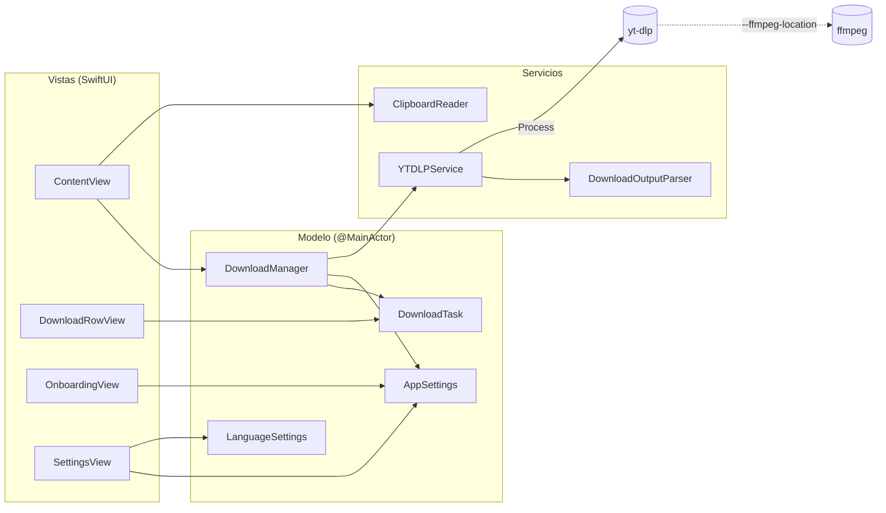
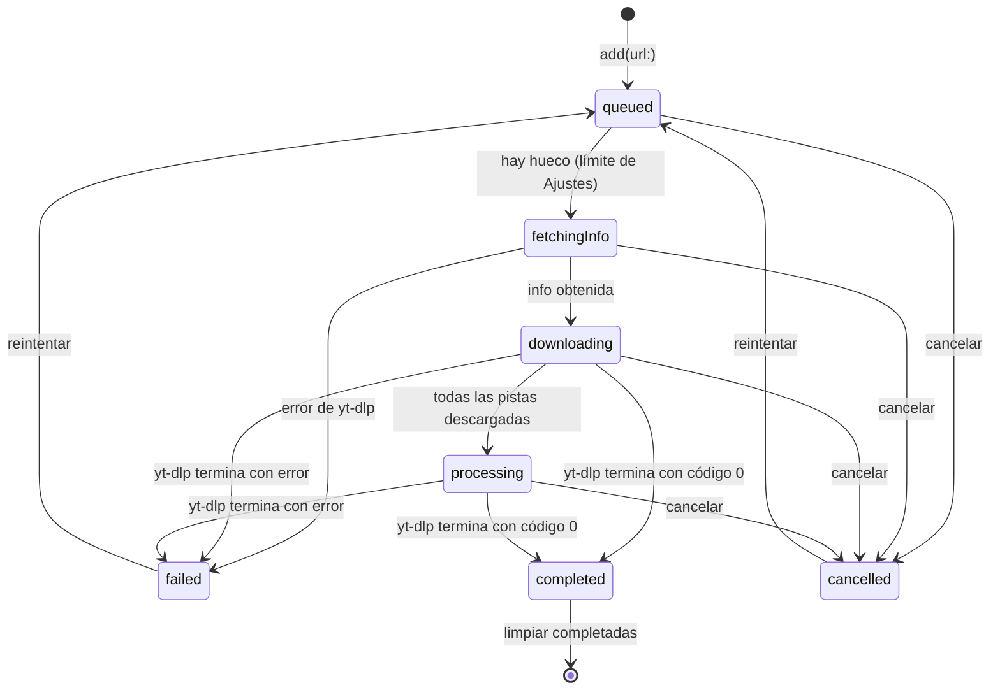

# Arquitectura

Loadr es una app SwiftUI pequeña que delega todo el trabajo de red y de conversión en dos binarios
externos: **yt-dlp** (descarga) y **ffmpeg** (unión de pistas y conversión a MP3). La app se encarga de
lanzarlos, interpretar su salida y presentarla.

- **Lenguaje:** Swift 6 en modo de concurrencia estricta.
- **UI:** SwiftUI con el framework Observation (`@Observable`).
- **Destino:** macOS 15 o superior.
- **Dependencias de código:** ninguna (sin paquetes de Swift Package Manager).

## Componentes



| Archivo | Responsabilidad |
| --- | --- |
| `LoadrApp.swift` | Escenas: la ventana principal y la de Ajustes. Es dueño del `DownloadManager`, así la cola sobrevive aunque se cierre la ventana. Quita "Nueva ventana" (⌘N): hay una sola cola y una sola ventana. |
| `Views/ContentView.swift` | Barra superior (URL, calidad, formato), aviso de herramientas faltantes, lista de descargas, alerta de playlist, bienvenida y pegado automático. |
| `Views/DownloadRowView.swift` | Una fila: miniatura, título, estado, tamaño descargado y total, velocidad, tiempo restante, barra de progreso y botón de acción. |
| `Views/OnboardingView.swift` | Bienvenida del primer arranque: carpeta de descargas y pegado automático. |
| `Views/SettingsView.swift` | Ajustes en dos pestañas: General (idioma, pegado automático) y Descargas (carpeta, descargas simultáneas). |
| `Views/FolderPicker.swift` | Panel para elegir carpeta, abrirla en Finder y mostrar su nombre como lo muestra Finder. |
| `Models/DownloadManager.swift` | Punto central: valida y limpia URLs, detecta playlists, gestiona la cola y orquesta cada descarga. |
| `Models/DownloadTask.swift` | Estado observable de una descarga (`DownloadStatus`, `TransferProgress`, archivo final, carpeta, proceso). |
| `Models/AppSettings.swift` | Preferencias generales: carpeta, límite de descargas simultáneas, pegado automático y bienvenida. |
| `Services/YTDLPService.swift` | Localiza los binarios, construye los argumentos y lanza `Process`. |
| `Services/YTDLPOutput.swift` | Protocolo de salida de Loadr con yt-dlp (`OutputProtocol`), su intérprete (`DownloadOutputParser`) y la suma del progreso de todas las pistas (`ProgressTracker`). |
| `Services/ClipboardReader.swift` | Lectura del portapapeles para el pegado automático y validación de URLs (`WebURL`). |
| `Localization/LanguageSettings.swift` | Preferencia de idioma y detección del idioma del sistema. |
| `Localization/L10n.swift` | Todos los textos visibles, en inglés y español. |

### Aislamiento y concurrencia

- `DownloadManager`, `DownloadTask`, `AppSettings` y `LanguageSettings` son `@Observable @MainActor`:
  todo su estado se lee y se modifica en el hilo principal, que es donde SwiftUI lo dibuja.
- `YTDLPService` es un `struct` `Sendable` sin estado mutable, así que se puede usar desde cualquier
  hilo o tarea.
- Los manejadores de `Process` (`readabilityHandler`, `terminationHandler`) corren en hilos de fondo.
  Escriben en `DownloadOutputParser` y `DataBuffer`, protegidos con `NSLock`, y comunican resultados
  mediante `AsyncThrowingStream` o `CheckedContinuation`.
- Para poder cancelar, el servicio entrega el `Process` recién creado con el callback `onLaunch`, y la
  tarea lo guarda en el actor principal.
- El `DownloadManager` observa `AppSettings.maxConcurrentDownloads` con `withObservationTracking`: si
  el usuario sube el límite en Ajustes, arranca enseguida las descargas en cola.
- Al recibir `NSApplication.willTerminateNotification` (salir de la app) termina los yt-dlp en marcha
  para no dejar procesos huérfanos.

## Ciclo de vida de una descarga



1. **Entrada.** `DownloadManager.add(url:)` limpia la URL (ver más abajo). Si es una playlist de
   YouTube, la lista con `fetchPlaylist` y deja una `PendingPlaylist` que la vista muestra como alerta.
   Si no, crea una `DownloadTask` en estado `.queued`.
2. **Cola.** Cada tarea en cola recibe un turno creciente (`queuePosition`). `pumpQueue()` arranca la
   tarea en cola con el turno más bajo mientras haya menos activas que `maxConcurrentDownloads`. La
   lista muestra lo más reciente arriba, pero eso no afecta al orden de descarga: los videos de una
   playlist se descargan en el orden de la playlist.
3. **Información.** Si la tarea no trae `VideoInfo` (las de playlist sí la traen), se ejecuta
   `fetchInfo` para obtener título, miniatura y duración.
4. **Carpeta.** La carpeta se decide al empezar: la subcarpeta de la playlist si el usuario la eligió
   y, si no, la de Ajustes. Si no se puede crear, la tarea falla con `folderUnavailable`.
5. **Descarga.** `download(...)` devuelve un `AsyncThrowingStream<DownloadEvent, Error>` que emite
   `.progress`, `.processing` y `.file`. Al terminar el stream sin error, la tarea pasa a `.completed`.
6. **Cancelación.** `DownloadTask.cancel()` termina el proceso si está en marcha y marca la tarea
   como `.cancelled`. El stream falla porque yt-dlp muere por señal; `start` ve que la tarea ya está
   cancelada e ignora ese error.
7. **Reintento.** `retry` limpia el progreso y vuelve a poner la tarea en cola con un turno nuevo (al
   final de la cola).

## Cómo se llama a yt-dlp

Los binarios se buscan, en este orden, en `/opt/homebrew/bin`, `/usr/local/bin` y la carpeta
`Resources` del bundle. No se usa `PATH`: al abrir una app desde Finder, `PATH` solo contiene las
rutas del sistema.

**Información de un video**

```sh
yt-dlp --no-playlist --no-warnings --no-colors -O "%(.{title,thumbnail,duration})j" URL
```

`-O` con la plantilla `.{campos}j` imprime un único objeto JSON con esos campos.

**Contenido de una playlist**

```sh
yt-dlp --flat-playlist --no-warnings --no-colors -O "%(.{id,title,url,ie_key,playlist_title,duration})j" URL
```

Imprime una línea JSON por video sin descargar nada. En YouTube, la miniatura se construye a partir
del id (`https://i.ytimg.com/vi/<id>/hqdefault.jpg`).

**Descarga**

```sh
yt-dlp --newline --no-playlist --no-colors --progress --no-simulate \
  --progress-template "download:LOADR-PROGRESS<TAB>%(info.format_id)s<TAB>%(progress.{status,downloaded_bytes,total_bytes,total_bytes_estimate,speed,eta})j" \
  --print "before_dl:LOADR-FORMATS<TAB>%(requested_formats.:.{format_id,filesize,filesize_approx})j<TAB>%(.{format_id,filesize,filesize_approx})j" \
  --print "after_move:LOADR-FILE<TAB>%(filepath)s" \
  -f "<formato>" \
  -o "<carpeta de descargas>[/<playlist>]/%(title)s.%(ext)s" \
  --ffmpeg-location /opt/homebrew/bin/ffmpeg \
  [--merge-output-format mp4|mkv|webm | -x --audio-format mp3] \
  URL
```

`<TAB>` es un tabulador real. Las plantillas viven en `OutputProtocol`, en `YTDLPOutput.swift`.

- `--print` implica `--quiet`: desaparecen los mensajes informativos de yt-dlp, pero no los avisos ni
  los errores. `--progress` mantiene el progreso a pesar del modo silencioso y `--no-simulate`
  asegura que la descarga ocurra.
- `--newline` hace que cada actualización de progreso vaya en su propia línea.

| Calidad (`QualityOption`) | ID guardado | `-f` |
| --- | --- | --- |
| Mejor calidad | `best` | `bv*+ba/b` |
| 1080p | `p1080` | `bv*[height<=1080]+ba/b[height<=1080]` |
| 720p | `p720` | `bv*[height<=720]+ba/b[height<=720]` |
| Solo audio (MP3) | `audio` | `ba` + `-x --audio-format mp3` |

| Formato (`ContainerOption`) | ID guardado | Argumento |
| --- | --- | --- |
| Automático | `auto` | ninguno |
| MP4 / MKV / WebM | `mp4` / `mkv` / `webm` | `--merge-output-format <id>` |

## Cómo se interpreta la salida

stdout y stderr van al mismo `Pipe`. `DownloadOutputParser` acumula **bytes** y solo decodifica
líneas completas, así un carácter UTF-8 (un acento o un emoji del título) partido entre dos lecturas
no hace perder la línea. Cada línea se clasifica por su etiqueta:

| Línea | Cuándo | Contenido | Resultado |
| --- | --- | --- | --- |
| `LOADR-FORMATS` | Antes de descargar | Pistas pedidas con `filesize` (exacto) o `filesize_approx` (estimado). Si es un único formato, la lista llega vacía y se usa el tercer campo. | Se anuncian las pistas al `ProgressTracker`. |
| `LOADR-PROGRESS` | Varias veces por segundo | Pista actual y JSON con `status`, `downloaded_bytes`, `total_bytes` o `total_bytes_estimate`, `speed` y `eta`. | `.progress(TransferProgress)`; cuando terminan todas las pistas, `.processing`. |
| `LOADR-FILE` | Al final | Ruta definitiva, ya unida, convertida y movida. | `.file(URL)` |
| Cualquier otra | — | Avisos y errores de yt-dlp (`WARNING:`, `ERROR:`). | Se guardan las últimas 8 para el mensaje de error. |

Ejemplo real de una descarga con video y audio separados:

```text
LOADR-FORMATS   [{"format_id": "v1", "filesize": 381111}, {"format_id": "a1", "filesize_approx": 130000}]   {"format_id": "v1+a1", "filesize_approx": 511111}
LOADR-PROGRESS  v1  {"status": "downloading", "downloaded_bytes": 130048, "total_bytes": 381111, "speed": 153410.6, "eta": 1}
LOADR-PROGRESS  v1  {"status": "finished", "downloaded_bytes": 381111, "total_bytes": 381111, "speed": 151862.4}
LOADR-PROGRESS  a1  {"status": "downloading", "downloaded_bytes": 64512, "total_bytes": 129542, "speed": 153205.5, "eta": 0}
LOADR-PROGRESS  a1  {"status": "finished", "downloaded_bytes": 129542, "total_bytes": 129542, "speed": 152901.3}
LOADR-FILE      /Users/…/Downloads/Loadr/Mi video.mp4
```

### Suma del progreso

`ProgressTracker` guarda, por pista, lo descargado y su tamaño: el `total_bytes` real si yt-dlp ya lo
sabe, si no `total_bytes_estimate`, y si la pista aún no empezó, el tamaño anunciado en
`LOADR-FORMATS`. Con eso calcula un único `TransferProgress`:

- **Descargado:** la suma de todas las pistas.
- **Total:** la suma de los tamaños; `nil` si alguno es desconocido (por ejemplo, en un directo). Si
  alguno es estimado, el total se marca como aproximado y la interfaz lo muestra con `~`.
- **Tiempo restante:** lo que falta del total dividido por la velocidad actual, así incluye el audio
  que aún no empezó. Sin total conocido, se usa el `eta` de yt-dlp.

En el ejemplo, la barra avanza de 0 a 100 % una sola vez (de 0 a 511 111 bytes estimados, que pasan a
510 653 exactos cuando empieza el audio) en lugar de llenarse dos veces.

La interfaz muestra los tamaños con las unidades de Finder (1 MB = 1 000 000 bytes), no con las MiB que
usa yt-dlp, para que coincidan con lo que el usuario verá después en Finder.

## Errores

`DownloadError` describe el motivo sin incluir texto traducido; la vista lo traduce con
`DownloadError.message`:

| Caso | Cuándo ocurre | Qué se muestra |
| --- | --- | --- |
| `invalidResponse` | yt-dlp no devolvió el JSON esperado. | Mensaje traducido. |
| `emptyPlaylist` | La playlist no tiene videos. | Mensaje traducido. |
| `folderUnavailable` | No se pudo crear la carpeta de descargas (por ejemplo, un disco desconectado). | Mensaje traducido con la ruta. |
| `exitCode(Int32)` | yt-dlp falló sin escribir nada. | Mensaje traducido con el código. |
| `output(String)` | yt-dlp falló y escribió algo. | Sus últimas líneas, tal cual. |
| `system(String)` | Cualquier otro error (por ejemplo, no se pudo lanzar el proceso). | `localizedDescription` del sistema. |

La fila muestra hasta 3 líneas del mensaje.

## Pegado automático

Al aparecer la ventana, al volver a Loadr (`NSApplication.didBecomeActiveNotification`) y al terminar
la bienvenida, `ContentView` comprueba el portapapeles si:

- el pegado automático está activado en Ajustes y la bienvenida ya se completó;
- el campo de la URL está vacío (nunca pisa lo que el usuario escribe);
- el `changeCount` del portapapeles cambió desde la última comprobación (no pega dos veces lo mismo).

Desde macOS 15.4, el sistema puede mostrar un aviso cuando una app lee el portapapeles sin que el
usuario pegue. Para molestar lo menos posible, `ClipboardReader`:

1. no lo intenta si `NSPasteboard.general.accessBehavior` es `.alwaysDeny`;
2. pregunta con `detectedPatterns(for: [\.probableWebURL])` si hay una URL, sin leer el contenido
   (esto no muestra aviso);
3. solo entonces lee el texto, fuera del hilo principal porque puede esperar a que el usuario responda,
   y lo acepta si es una URL `http` o `https` válida (`WebURL.isValid`).

## Limpieza de URLs

- **YouTube** (`youtube.com`, `youtu.be`, `youtube-nocookie.com` y subdominios): se conservan solo
  `v`, `t` y `list` (en `youtu.be`, solo `t`) y se quita el fragmento `#…`.
- **Resto de sitios:** se quitan `utm_*`, `si`, `igsh`, `fbclid`, `gclid`, `dclid`, `mc_cid` y `mc_eid`.

Una URL se trata como playlist solo si es de YouTube, su ruta empieza por `/playlist` y tiene `list`.
Un enlace `watch?v=…&list=…` descarga solo el video, porque la descarga usa `--no-playlist`.

## Persistencia

Todo se guarda en `UserDefaults` del dominio `com.loadr.loadr`:

| Clave | Valor | Escrita por |
| --- | --- | --- |
| `defaultQuality` | ID de `QualityOption` (`best`, `p1080`, `p720`, `audio`) | `DownloadManager.quality` |
| `defaultContainer` | ID de `ContainerOption` (`auto`, `mp4`, `mkv`, `webm`) | `DownloadManager.container` |
| `downloadFolderPath` | Ruta de la carpeta de descargas; ausente = `~/Downloads/Loadr` | `AppSettings.downloadFolder` |
| `maxConcurrentDownloads` | Entero de 1 a 10; ausente = 3 | `AppSettings.maxConcurrentDownloads` |
| `autoPasteURLs` | Booleano; ausente = activado | `AppSettings.autoPasteURLs` |
| `hasCompletedOnboarding` | Booleano; ausente = mostrar la bienvenida | `AppSettings.hasCompletedOnboarding` |
| `AppleLanguages` | `["en"]` o `["es"]`; ausente si se usa el idioma del sistema | `LanguageSettings` (ver [Idiomas](idiomas.md)) |

Los IDs son independientes del texto de la interfaz, así que traducir o renombrar una opción no rompe
la preferencia guardada.

Para volver a la configuración inicial (y ver otra vez la bienvenida):

```sh
defaults delete com.loadr.loadr
```

## Limitaciones conocidas

- Requiere una versión reciente de yt-dlp: las versiones muy antiguas no entienden `--print` con
  etapas como `before_dl` o `after_move`.
- Sin tamaño anunciado (directos y algunos sitios), solo se muestra lo descargado y la barra queda
  indeterminada.
- La app no está firmada con Developer ID ni notarizada; las releases van firmadas ad hoc.
