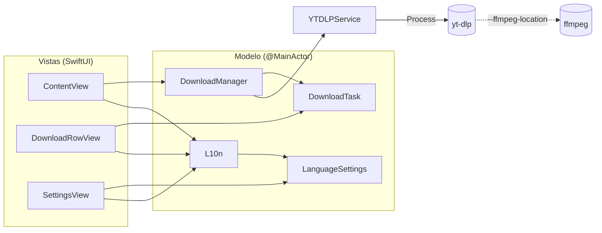
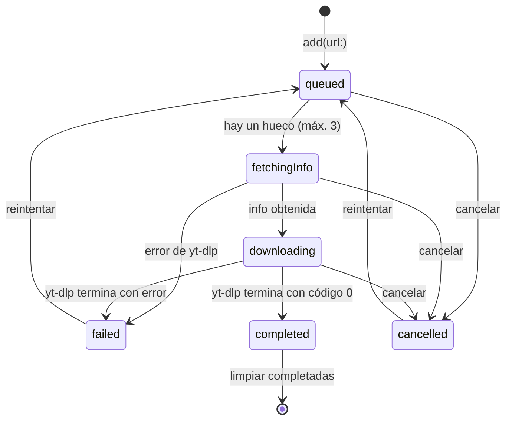

# Arquitectura

Loadr es una app SwiftUI pequeña que delega todo el trabajo de red y de conversión en dos binarios
externos: **yt-dlp** (descarga) y **ffmpeg** (unión de pistas y conversión a MP3). La app se encarga de
lanzarlos, interpretar su salida y presentarla.

- **Lenguaje:** Swift 6 en modo de concurrencia estricta.
- **UI:** SwiftUI con el framework Observation (`@Observable`).
- **Destino:** macOS 15 o superior.
- **Dependencias de código:** ninguna (sin paquetes de Swift Package Manager).

## Componentes



| Archivo | Responsabilidad |
| --- | --- |
| `LoadrApp.swift` | Declara las escenas: la ventana principal (`WindowGroup`) y la ventana de Ajustes (`Settings`). |
| `Views/ContentView.swift` | Barra superior (URL, calidad, formato), aviso de herramientas faltantes, lista de descargas y alerta de playlist. |
| `Views/DownloadRowView.swift` | Una fila: miniatura, título, estado, progreso y botón de acción (cancelar, mostrar en Finder o reintentar). |
| `Views/SettingsView.swift` | Selector de idioma. |
| `Models/DownloadManager.swift` | Punto central: valida y limpia URLs, detecta playlists, gestiona la cola y orquesta cada descarga. |
| `Models/DownloadTask.swift` | Estado observable de una descarga (`DownloadStatus`, porcentaje, velocidad, ETA, archivo final, proceso). |
| `Services/YTDLPService.swift` | Localiza los binarios, construye los argumentos, lanza `Process` y convierte la salida en datos (`VideoInfo`, `DownloadEvent`, `DownloadError`). |
| `Localization/LanguageSettings.swift` | Preferencia de idioma y detección del idioma del sistema. |
| `Localization/L10n.swift` | Todos los textos visibles, en inglés y español. |

### Aislamiento y concurrencia

- `DownloadManager`, `DownloadTask` y `LanguageSettings` son `@Observable @MainActor`: todo su estado
  se lee y se modifica en el hilo principal, que es donde SwiftUI lo dibuja.
- `YTDLPService` es un `struct` `Sendable` sin estado mutable, así que se puede usar desde cualquier
  hilo o tarea.
- Los manejadores de `Process` (`readabilityHandler`, `terminationHandler`) corren en hilos de fondo.
  Escriben en `LineBuffer` y `DataBuffer`, dos clases protegidas con `NSLock`, y comunican resultados
  mediante `AsyncThrowingStream` o `CheckedContinuation`.
- Para poder cancelar, el servicio entrega el `Process` recién creado con el callback `onLaunch`, y la
  tarea lo guarda en el actor principal.

## Ciclo de vida de una descarga



1. **Entrada.** `DownloadManager.add(url:)` limpia la URL (ver más abajo). Si es una playlist de
   YouTube, la lista con `fetchPlaylist` y deja una `PendingPlaylist` que la vista muestra como alerta.
   Si no, crea una `DownloadTask` en estado `.queued`.
2. **Cola.** Cada tarea en cola recibe un turno creciente (`queuePosition`). `pumpQueue()` arranca la
   tarea en cola con el turno más bajo mientras haya menos de 3 activas. La lista visual muestra lo más
   reciente arriba, pero eso no afecta al orden de descarga: los videos de una playlist se descargan en
   el orden de la playlist.
3. **Información.** Si la tarea no trae `VideoInfo` (las de playlist sí la traen), se ejecuta
   `fetchInfo` para obtener título, miniatura y duración.
4. **Descarga.** `download(...)` devuelve un `AsyncThrowingStream<DownloadEvent, Error>` que emite
   `.progress` y `.file`. Al terminar el stream sin error, la tarea pasa a `.completed`.
5. **Cancelación.** `DownloadTask.cancel()` termina el proceso si está en marcha y marca la tarea
   como `.cancelled`. El stream falla porque yt-dlp muere por señal; `start` ve que la tarea ya está
   cancelada e ignora ese error.
6. **Reintento.** `retry` limpia el progreso y vuelve a poner la tarea en cola con un turno nuevo (al
   final de la cola).

## Cómo se llama a yt-dlp

Los binarios se buscan, en este orden, en `/opt/homebrew/bin`, `/usr/local/bin` y la carpeta
`Resources` del bundle. No se usa `PATH`: al abrir una app desde Finder, `PATH` solo contiene las
rutas del sistema.

**Información de un video**

```sh
yt-dlp --no-playlist --no-warnings --no-colors -O "%(.{title,thumbnail,duration})j" URL
```

`-O` con la plantilla `.{campos}j` imprime un único objeto JSON con esos campos.

**Contenido de una playlist**

```sh
yt-dlp --flat-playlist --no-warnings --no-colors -O "%(.{id,title,url,ie_key,playlist_title,duration})j" URL
```

Imprime una línea JSON por video sin descargar nada. En YouTube, la miniatura se construye a partir
del id (`https://i.ytimg.com/vi/<id>/hqdefault.jpg`).

**Descarga**

```sh
yt-dlp --newline --no-playlist --no-colors \
  -f "<formato>" \
  -o "~/Downloads/Loadr[/<playlist>]/%(title)s.%(ext)s" \
  --ffmpeg-location /opt/homebrew/bin/ffmpeg \
  [--merge-output-format mp4|mkv|webm | -x --audio-format mp3] \
  URL
```

| Calidad (`QualityOption`) | ID guardado | `-f` |
| --- | --- | --- |
| Mejor calidad | `best` | `bv*+ba/b` |
| 1080p | `p1080` | `bv*[height<=1080]+ba/b[height<=1080]` |
| 720p | `p720` | `bv*[height<=720]+ba/b[height<=720]` |
| Solo audio (MP3) | `audio` | `ba` + `-x --audio-format mp3` |

| Formato (`ContainerOption`) | ID guardado | Argumento |
| --- | --- | --- |
| Automático | `auto` | ninguno |
| MP4 / MKV / WebM | `mp4` / `mkv` / `webm` | `--merge-output-format <id>` |

`--newline` hace que yt-dlp escriba cada actualización de progreso en una línea nueva en vez de
reescribir la misma con `\r`.

## Cómo se interpreta la salida

stdout y stderr van al mismo `Pipe`. Los datos llegan en trozos arbitrarios, así que `LineBuffer`
acumula texto y solo entrega **líneas completas**; además guarda las últimas 8 líneas no vacías para
usarlas como mensaje de error.

| Línea de yt-dlp | Resultado |
| --- | --- |
| `[download]  42.0% of ~ 12.34MiB at 1.23MiB/s ETA 00:10` | `.progress(percent: 42.0, speed: "1.23MiB/s", eta: "00:10")` |
| `[download] Destination: /ruta/archivo.f137.mp4` | `.file(URL)` |
| `[ExtractAudio] Destination: /ruta/archivo.mp3` | `.file(URL)` |
| `[Merger] Merging formats into "/ruta/archivo.mp4"` | `.file(URL)`: el archivo final tras unir pistas |

yt-dlp alinea tamaños y velocidades a 10 caracteres (`of ~  83.62MiB`, `at    512.00B/s`). La
expresión regular del progreso tolera ese relleno, los tamaños estimados (`~`, típicos de descargas
por fragmentos) y la velocidad `Unknown B/s` que aparece al empezar. Las líneas con `ETA Unknown` se
ignoran hasta que yt-dlp puede calcular el tiempo restante. Como el último `.file` recibido es el que se queda, "Mostrar en Finder"
selecciona el archivo final y no los fragmentos intermedios.

> Pendiente: usar `--progress-template` para que yt-dlp emita el progreso en un formato pensado para
> máquinas y no depender del texto para humanos.

## Errores

`DownloadError` describe el motivo sin incluir texto traducido; la vista lo traduce con
`DownloadError.message`:

| Caso | Cuándo ocurre | Qué se muestra |
| --- | --- | --- |
| `invalidResponse` | yt-dlp no devolvió el JSON esperado. | Mensaje traducido. |
| `emptyPlaylist` | La playlist no tiene videos. | Mensaje traducido. |
| `exitCode(Int32)` | yt-dlp falló sin escribir nada. | Mensaje traducido con el código. |
| `output(String)` | yt-dlp falló y escribió algo. | Sus últimas líneas, tal cual. |
| `system(String)` | Cualquier otro error (por ejemplo, no se pudo lanzar el proceso). | `localizedDescription` del sistema. |

La fila muestra hasta 3 líneas del mensaje.

## Limpieza de URLs

- **YouTube** (`youtube.com`, `youtu.be`, `youtube-nocookie.com` y subdominios): se conservan solo
  `v`, `t` y `list` (en `youtu.be`, solo `t`) y se quita el fragmento `#…`.
- **Resto de sitios:** se quitan `utm_*`, `si`, `igsh`, `fbclid`, `gclid`, `dclid`, `mc_cid` y `mc_eid`.

Una URL se trata como playlist solo si es de YouTube, su ruta empieza por `/playlist` y tiene `list`.
Un enlace `watch?v=…&list=…` descarga solo el video, porque la descarga usa `--no-playlist`.

## Persistencia

Todo se guarda en `UserDefaults` del dominio `com.loadr.loadr`:

| Clave | Valor | Escrita por |
| --- | --- | --- |
| `defaultQuality` | ID de `QualityOption` (`best`, `p1080`, `p720`, `audio`) | `DownloadManager.quality` |
| `defaultContainer` | ID de `ContainerOption` (`auto`, `mp4`, `mkv`, `webm`) | `DownloadManager.container` |
| `AppleLanguages` | `["en"]` o `["es"]`; ausente si se usa el idioma del sistema | `LanguageSettings` (ver [Idiomas](idiomas.md)) |

Los IDs son independientes del texto de la interfaz, así que traducir o renombrar una opción no rompe
la preferencia guardada.

Para volver a la configuración inicial:

```sh
defaults delete com.loadr.loadr
```

## Limitaciones conocidas

- La carpeta de destino es fija (`~/Downloads/Loadr`).
- Cada ventana nueva (⌘N) tiene su propio `DownloadManager`, con su propia cola.
- El progreso depende del formato de texto de yt-dlp; un cambio en ese formato puede dejar la barra
  de progreso quieta, aunque la descarga sigue y termina bien.
- La app no está firmada ni notarizada.
